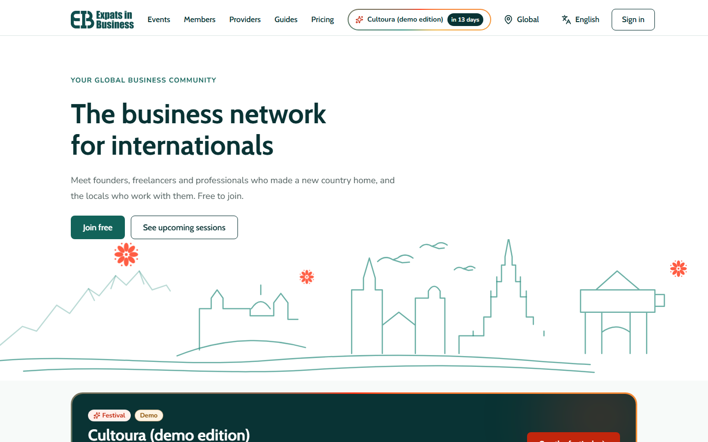
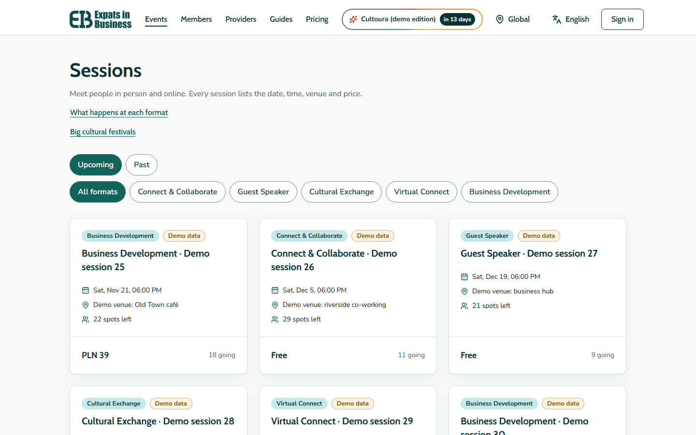
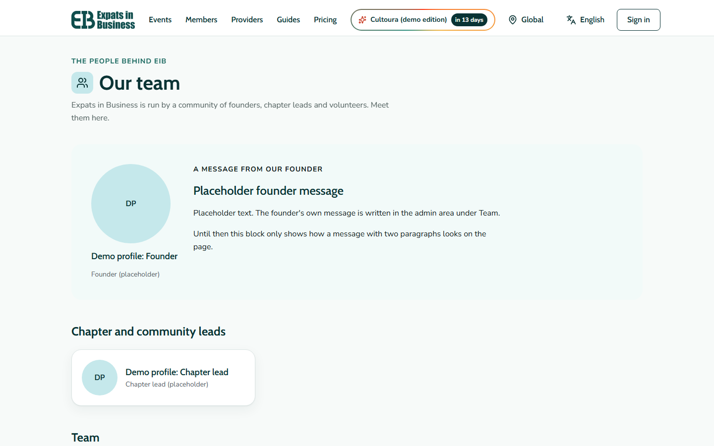
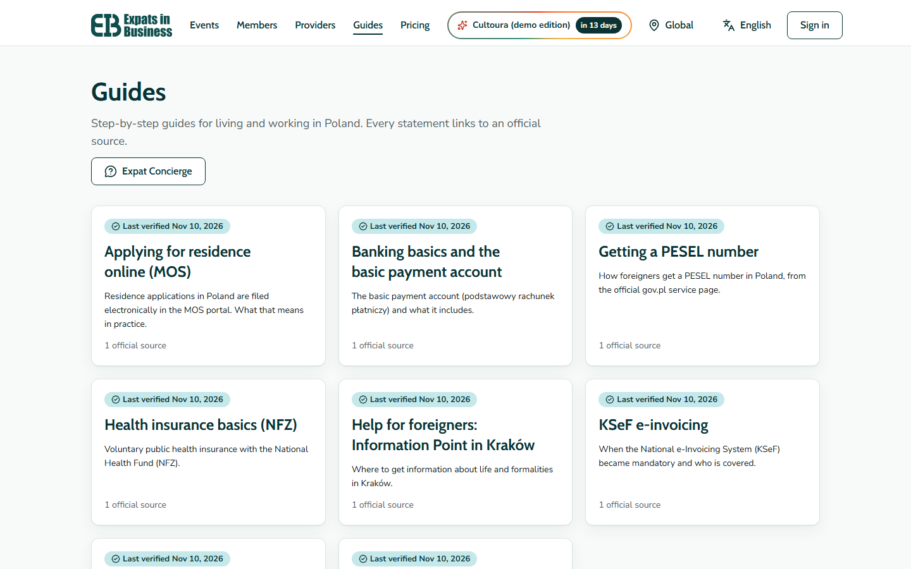
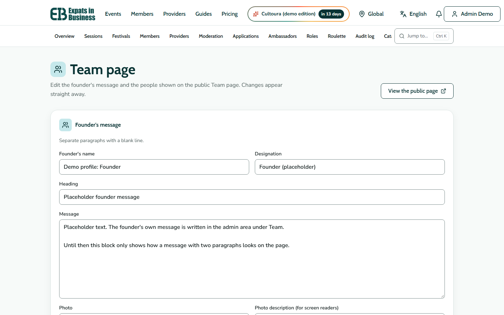
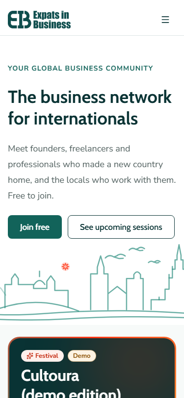
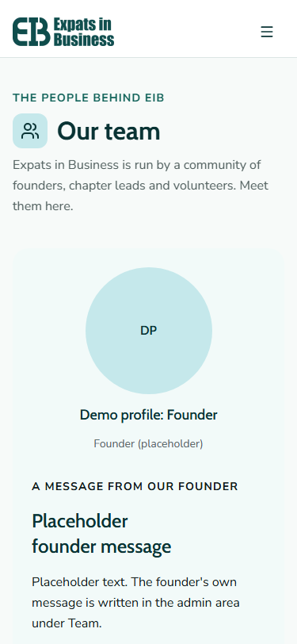
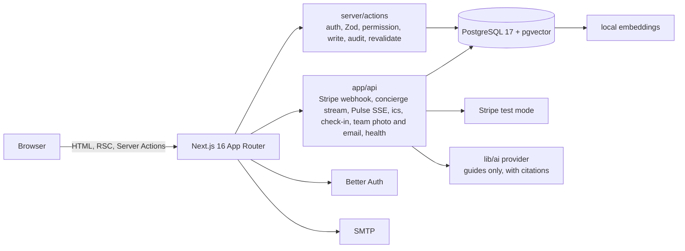

<p align="center">
  
</p>

<h3 align="center">Your Global Business Community!</h3>

<p align="center">
  The platform of <strong>Expats in Business (EiB)</strong>: a free, community-run business network for
  internationals, founded in Kraków in 2024. One global product, organised into chapters.
</p>

<p align="center">
  
  
  
  
  
</p>

<p align="center">
  
</p>

> **Private and proprietary.** This repository belongs to Expats in Business. It may be used only by
> Expats in Business and people it has authorised in writing. Read [LICENSE](LICENSE) before you use, copy
> or share anything here.

---

## Contents

1. [What EiB is](#what-eib-is)
2. [Features](#features)
3. [Screenshots](#screenshots)
4. [Tech stack](#tech-stack)
5. [Architecture](#architecture)
6. [Quick start](#quick-start)
7. [Demo accounts](#demo-accounts)
8. [Commands](#commands)
9. [Project structure](#project-structure)
10. [Quality: tests, accessibility, performance](#quality-tests-accessibility-performance)
11. [Security and privacy](#security-and-privacy)
12. [Deployment](#deployment)
13. [Documentation](#documentation)
14. [Roadmap and known gaps](#roadmap-and-known-gaps)
15. [License](#license)

## What EiB is

Expats in Business is a free, community-run network of internationals who build businesses and careers
abroad. It started in Kraków and runs sessions such as Connect & Collaborate, Guest Speaker, Cultural
Exchange and Business Development workshops. This platform replaces the old portal with **one global
product** organised as:

```
Global  →  Country hub (Poland first)  →  City chapter (Kraków is chapter #1, Warsaw launching)
```

**Cultural Bubbles**, groups by country of origin each led by a Bubble Lead, cut across every chapter.
Every city, currency and time zone comes from the chapter's configuration, so a new chapter needs data, not code.

## Features

| Area                         | What people get                                                                                                                                                                 |
| ---------------------------- | ------------------------------------------------------------------------------------------------------------------------------------------------------------------------------- |
| **Sessions and events**      | Event list and pages, RSVP and un-RSVP, waitlist with automatic promotion, paid tickets in Stripe test mode (card, BLIK, Przelewy24), QR tickets, `.ics` calendar files         |
| **Check-in**                 | QR scanner for chapter leads, a live "Session Pulse" screen, and "Who I met" with opt-in connections                                                                            |
| **Festivals**                | Builder and console (ticket tiers, programme, volunteer shifts, stalls, partners, FAQ), group tickets, volunteer and stall applications, sponsor reports, a site-wide spotlight |
| **Community**                | Profiles, member directory, double opt-in connections, chapter groups, moderation, a Bubbles world map, weekly Coffee Roulette                                                  |
| **Providers and businesses** | Verified provider directory, quote requests, provider inbox with analytics, business listings                                                                                   |
| **Guides and AI concierge**  | Guides that cite official sources and carry a `lastVerified` date; a concierge that answers **only** from those guides, with citations, or hands over to a human                |
| **Landing Roadmap**          | A personal 30/60/90-day settling-in plan by residence situation, reminders and calendar export                                                                                  |
| **Growth**                   | Chapters world view, city votes, country and city pages, ambassador programme, careers, volunteering                                                                            |
| **Team page**                | Founder's message and the people behind EiB, edited by admins with photo upload; emails are shown only with consent                                                             |
| **Membership**               | Plans, subscriptions (test mode) and corporate enquiries. Prices are placeholders until EiB confirms them                                                                       |
| **Admin command centre**     | KPIs and charts, sessions, festivals, members, providers, moderation, applications, ambassadors, roles, catalogs, settings and feature flags, audit log, system health          |
| **Platform**                 | English, Polish and Ukrainian; chapter time zone and currency; SEO (hreflang, JSON-LD, social cards); GDPR data export and deletion; rate limits; audit log                     |

## Screenshots

|                                                                                   |                                                                                      |
| --------------------------------------------------------------------------------- | ------------------------------------------------------------------------------------ |
|  **Events**                         |  **Team page**                        |
|  **Guides**                         |  **Admin: team editor** |
|  **Home on a phone (375 px)** |  **Team on a phone**             |

All people, providers, venues and numbers in the demo are fictional and labelled "Demo profile" or similar.

## Tech stack

| Layer                | Choice                                                                                                                                                                 |
| -------------------- | ---------------------------------------------------------------------------------------------------------------------------------------------------------------------- |
| Framework            | Next.js 16 (App Router, Server Components, Server Actions, Cache Components), TypeScript strict                                                                        |
| UI                   | Tailwind CSS v4, shadcn/ui, Motion, Cabin and Nunito Sans fonts                                                                                                        |
| Data                 | PostgreSQL 17 with pgvector, Prisma ORM 7 (`@prisma/adapter-pg`)                                                                                                       |
| Auth                 | Better Auth: email sign-in links, optional Google, sessions                                                                                                            |
| Validation and forms | Zod, React Hook Form                                                                                                                                                   |
| AI                   | Vercel AI SDK v6 behind `lib/ai/provider.ts` (Groq, Gemini, OpenRouter, Anthropic or the offline demo provider); local embeddings (`all-MiniLM-L6-v2`, 384 dimensions) |
| Payments             | Stripe in **test mode** only (card, BLIK, Przelewy24)                                                                                                                  |
| Email                | SMTP (Mailpit locally, any SMTP provider in production)                                                                                                                |
| i18n                 | next-intl: English, Polish, Ukrainian                                                                                                                                  |
| Content              | MDX guides and legal pages                                                                                                                                             |
| Maps                 | d3-geo SVG maps, no tile services                                                                                                                                      |
| Tests                | Vitest and Testing Library; Playwright with axe-core and a link crawler                                                                                                |

## Architecture



**One rule for every write:** require a role or entitlement, parse with Zod, check the permission against the
database, write, record an audit entry for admin actions, then revalidate the cache.

## Quick start

Prerequisites: **Node 24 LTS**, **Git** and **Docker Desktop** (for PostgreSQL with pgvector and Mailpit).
Windows, macOS and Linux are supported; the scripts are Node, not shell.

```bash
git clone <your private repository URL>
cd eib-platform
npm run setup     # first run: install, start Docker services, migrate, seed, embed guides
npm run dev       # app: http://localhost:3000   emails: http://localhost:8025 (Mailpit)
```

The local database listens on port **5433**, so a PostgreSQL already installed on 5432 does not clash.
Copy-and-edit values live in [`.env.example`](.env.example); `npm run setup` creates `.env` for you and never
reads an existing one.

**Demos on a low-memory laptop:** `next dev` can use about 1.7 GB, and orphaned dev servers can survive a
restart. For a demo run `npm run build && npm start`. If the app misbehaves, stop leftover `node` processes,
delete the `.next` folder and start again.

## Demo accounts

Demo mode only (`DEMO_MODE=true`). **Never deploy a public site in demo mode.**

| Role              | Email                         | Password  |
| ----------------- | ----------------------------- | --------- |
| Admin             | admin@demo.eib.local          | Demo!2026 |
| Chapter lead      | lead@demo.eib.local           | Demo!2026 |
| Member (newcomer) | priya@demo.eib.local          | Demo!2026 |
| Member (founder)  | karim@demo.eib.local          | Demo!2026 |
| Provider          | marta.provider@demo.eib.local | Demo!2026 |
| Sponsor           | sponsor@demo.eib.local        | Demo!2026 |

Sign-in links arrive in Mailpit at http://localhost:8025. Payments use Stripe test mode.

## Commands

| Command                                  | What it does                                                                        |
| ---------------------------------------- | ----------------------------------------------------------------------------------- |
| `npm run setup`                          | First run: install, Docker up, migrate, seed, embed guides                          |
| `npm run dev`                            | Development server on port 3000                                                     |
| `npm run build` then `npm start`         | Production build and server                                                         |
| `npm run check`                          | Lint, typecheck and unit tests (run before every commit)                            |
| `npm run e2e`                            | Playwright tests, including accessibility and the link crawler (needs the database) |
| `npm run crawl`                          | Link crawler on its own                                                             |
| `npm run lighthouse`                     | Lighthouse audit against a running production server                                |
| `npm run demo:reset`                     | Restore the demo data                                                               |
| `npm run db:reset`                       | **Erases** the local database and reseeds it                                        |
| `npm run db:seed -- --base-only`         | Real configuration only (production seed)                                           |
| `npm run embed`                          | Index the guides for the concierge                                                  |
| `npm run jobs -- reminders` / `roulette` | Scheduled jobs                                                                      |
| `npm run admin:grant -- email`           | Make an existing account an admin                                                   |
| `npm run stripe:listen`                  | Forward Stripe test webhooks (needs the Stripe CLI)                                 |

## Project structure

```
app/[locale]/(public)    marketing, events, festivals, chapters, guides, team, pricing, legal
app/[locale]/(member)    dashboard, tickets, roadmap, concierge, connections, bubbles, settings
app/[locale]/(provider)  provider inbox and analytics
app/[locale]/(admin)     admin and chapter-lead tools
app/[locale]/(tools)     developer pages such as /styleguide (development and demo mode only)
app/api                  routes for outside callers only
components/              ui (shadcn), motion, layout, one folder per feature
lib/                     auth, permissions, ai, db, env, i18n, money, time, security, features
server/actions/          one file per feature
config/                  facts, partners, plans, chapter defaults, feature flags
prisma/                  schema, migrations, seed (base = real config, demo = fictional)
content/                 MDX guides and legal pages
messages/                en, pl, uk
tests/                   unit (Vitest) and e2e (Playwright)
docs/                    brief, plan, decisions, progress, audit, deployment, test report
```

## Quality: tests, accessibility, performance

- **Unit tests:** Vitest, run by `npm run check` together with ESLint and a strict TypeScript check.
- **End-to-end tests:** Playwright at 1440 px and 375 px, with axe-core accessibility checks and a link
  crawler that fails on dead links and no-op buttons.
- **Accessibility:** semantic HTML, labels, visible focus, 44 px touch targets, reduced-motion support, and
  colour pairs that must pass WCAG contrast (a test enforces them).
- **Performance:** Lighthouse mobile targets are 90 or more in every category (`npm run lighthouse`).
- The latest results are in [docs/TEST_REPORT.md](docs/TEST_REPORT.md).

## Security and privacy

- Every Server Action authenticates, validates with Zod, checks permissions in the database and rate-limits.
- Strict Content Security Policy and other security headers (`next.config.ts`); secrets are validated by Zod at startup.
- Stripe webhooks are signature-verified; amounts are never trusted from the client.
- No personal data is sent to an AI model: prompts hold only the question and retrieved guide passages.
- GDPR: consent before non-essential cookies, data export and deletion in settings, aggregates under 5 people hidden.
- Uploaded photos are decoded and re-encoded (EXIF stripped); team emails appear only on request and with consent.
- Report a vulnerability privately to the repository owners; do not open public issues for security problems.

## Deployment

A free, step-by-step guide (Render, Neon, Brevo, GitHub Actions) is in [docs/DEPLOY.md](docs/DEPLOY.md).
Short version: run the migrations and the base seed against a Postgres with pgvector, set `DEMO_MODE=false`,
provide the environment variables from `.env.example`, build with `npm run build`, start with `npm start`.

## Documentation

| Document                                                                          | Purpose                                                   |
| --------------------------------------------------------------------------------- | --------------------------------------------------------- |
| [docs/PROJECT_BRIEF.md](docs/PROJECT_BRIEF.md)                                    | The brief                                                 |
| [docs/PROJECT_OVERVIEW.md](docs/PROJECT_OVERVIEW.md)                              | Features, data model, architecture, concierge flow        |
| [docs/BUILD_PLAN.md](docs/BUILD_PLAN.md) and [docs/PROGRESS.md](docs/PROGRESS.md) | Milestones and the progress log                           |
| [docs/DECISIONS.md](docs/DECISIONS.md)                                            | Design and security decisions                             |
| [docs/FACTS.md](docs/FACTS.md)                                                    | The only verified company facts, each with a source       |
| [docs/AUDIT.md](docs/AUDIT.md)                                                    | Codebase audit                                            |
| [docs/DEPLOY.md](docs/DEPLOY.md)                                                  | Free deployment guide                                     |
| [docs/TEST_REPORT.md](docs/TEST_REPORT.md)                                        | Full platform test report                                 |
| [docs/EiB-Platform-Overview.pdf](docs/EiB-Platform-Overview.pdf)                  | Illustrated overview for EiB, stakeholders and developers |
| [CLAUDE.md](CLAUDE.md)                                                            | Working rules for the AI coding assistant                 |

## Roadmap and known gaps

**Roadmap:** MVP (this build) → V1 paid pilot in Kraków → V2 Poland → global.

Until Expats in Business confirms them, these are labelled placeholders, never facts: prices and plans,
sponsors and partners, festival dates, the refund policy and ambassador benefits. Polish and Ukrainian texts
are machine-translated and need review by native speakers. The legal pages need a lawyer's review before
real members join. Stripe runs in test mode only.

## License

Copyright (c) 2024-2026 Expats in Business. All rights reserved. This is proprietary software for the
exclusive use of Expats in Business; no license is granted to anyone else. See [LICENSE](LICENSE).
