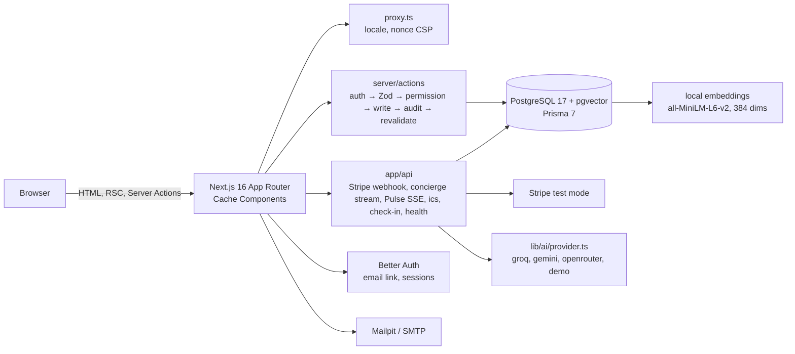

# EiB platform: project overview

## What EiB is

Expats in Business (EiB) is a free, community-run business network for internationals, founded in
Kraków in 2024 ("Your Global Business Community!", docs/FACTS.md). This repository is its new platform,
replacing portal.expatsinbusiness.org. It is one global product organised as Global → Country hub
(Poland first) → City chapter (Kraków live, Warsaw launching). Cultural Bubbles (groups by country of
origin) cut across chapters. Demo-only geography (India, Indore) and every other demo record are
flagged `isDemo` and labelled on screen.

## Features

| Area                     | What members and teams get                                                                                                                                             |
| ------------------------ | ---------------------------------------------------------------------------------------------------------------------------------------------------------------------- |
| Sessions                 | Event list and pages, RSVP / un-RSVP, waitlist with automatic promotion, paid tickets (Stripe test mode, BLIK, Przelewy24), QR tickets, `.ics` calendar                |
| Check-in                 | QR scanner for leads, live Pulse (SSE), "Who I met" with opt-in connections                                                                                            |
| Festivals                | Builder and console (tiers, programme, shifts, stalls, partners, FAQ), group tickets, volunteer shifts, stall applications, signed sponsor report, site-wide spotlight |
| Community                | Profiles, directory, connections, chapter groups, moderation, Bubbles map, Coffee Roulette                                                                             |
| Providers and businesses | Verified provider directory, quote requests, provider inbox and analytics, business listings                                                                           |
| Guides and concierge     | Official-source guides (`lastVerified`), AI concierge that only answers from guides, with citations                                                                    |
| Landing Roadmap          | Personal settling-in tasks by residence situation, reminders, `.ics` export                                                                                            |
| Growth                   | Chapters world view, city votes, country and city pages with landmark art, ambassador programme (global, country, city), careers, volunteering                         |
| Membership               | Plans (placeholder prices), subscriptions, corporate enquiry                                                                                                           |
| Admin                    | Command centre (KPIs, charts), sessions, festivals, members, providers, moderation, applications, ambassadors, roles, catalogs, settings, audit log, system            |
| Platform                 | en / pl / uk, chapter time zone and currency, SEO (hreflang, JSON-LD, social cards), GDPR export and deletion, rate limits, audit log                                  |

## Architecture



## Data model (68 Prisma models), main groups

- **Identity:** User, Session, Account, Profile, Consent, ChapterRole (role per chapter), Notification.
- **Geography:** Country, Chapter, ChapterRequest and votes, Venue.
- **Events:** EventFormat, Event (session or festival), TicketType, Ticket, CheckIn, EventProgrammeItem,
  VolunteerShift and signups, StallApplication, EventFaq, Sponsor, Sponsorship, EventPhoto.
- **Community:** Connection, Bubble and members, Group, Post, reactions and reports, Roulette rounds and matches.
- **Directory:** Business, Provider, ProviderCategory, verification, QuoteRequest, Review, daily stats.
- **Knowledge:** Guide, GuideChunk (vector), ConciergeQuery, RoadmapTemplate, RoadmapTask, UserTask.
- **Growth:** AmbassadorApplication, Ambassador, OpenRole, RoleApplication, Application.
- **Billing and ops:** Plan, Subscription, StripeEvent, AuditLog, RateLimit, SiteSetting, Badge, PointsEntry.

## Roles

`member` (default), `bubble_lead`, `moderator`, `chapter_lead` (per chapter), `admin` (global), and
`ambassador` (public title, no admin powers). Plan tiers (community, plus, business, provider, corporate)
gate entitlements separately. Permissions live in `lib/auth/permissions.ts`; every action re-checks them.

## AI concierge flow

1. Question in, rate-limited; no personal data is sent to a model (`lib/ai/redact.ts`).
2. Retrieval: top 5 guide passages by vector similarity, keyword fallback (`lib/ai/retrieval.ts`).
3. Prompt holds only the question and the passages (`lib/ai/prompt.ts`).
4. Answer gate (`lib/ai/concierge.ts`): every sentence must cite a retrieved passage and be grounded in
   it; otherwise the whole answer becomes a hand-off to a human. Only then is it streamed with sources.
5. Without an API key the demo provider answers from the same guides, so the demo works offline.

## Folder map

| Path                                            | Contents                                                                               |
| ----------------------------------------------- | -------------------------------------------------------------------------------------- |
| `app/[locale]/(public)`                         | marketing, events, festivals, chapters, guides, pricing, legal, growth pages           |
| `app/[locale]/(member)`                         | dashboard, tickets, connections, roadmap, concierge, settings                          |
| `app/[locale]/(provider)`, `(admin)`, `(tools)` | provider area, admin and chapter-lead tools, `/styleguide`                             |
| `app/api`                                       | external callers only                                                                  |
| `components/*`                                  | `ui` (shadcn), `motion`, `layout`, one folder per feature                              |
| `lib/*`                                         | auth, permissions, ai, db, env, i18n, money, time, events, festivals, growth, security |
| `server/actions/*`                              | one file per feature                                                                   |
| `config/`                                       | facts registry, partners, plans, chapter defaults, feature flags                       |
| `prisma/`                                       | schema, migrations, seed `base` (real config) and `demo` (isDemo)                      |
| `content/`, `messages/`                         | MDX guides and legal pages; en / pl / uk catalogues                                    |
| `tests/unit`, `tests/e2e`                       | Vitest; Playwright with axe and link crawler                                           |

## Run it (Windows, Node 24, Docker)

```bash
npm run setup      # install, docker compose up, migrate, seed, embed guides
npm run dev        # http://localhost:3000, Mailpit on http://localhost:8025
npm run check      # lint + typecheck + unit tests
npm run e2e        # Playwright (needs the dev database)
npm run demo:reset # restore the demo data
```

Demo accounts: see the seed (`prisma/seed/demo/people.ts`, password in `context.ts`).

## Known gaps

- Real prices, sponsors, partners, festival dates, refund policy and ambassador benefits are placeholders
  until EiB confirms them.
- Polish and Ukrainian are machine-translated and not reviewed by native speakers.
- Legal pages need a lawyer's review before go-live.
- Not deployed yet: hosting, managed Postgres with pgvector, domain, live Stripe and email are open
  (docs/DEPLOY.md, to be written).
- The dev server is memory-hungry on the development laptop; use a production build for demos.
